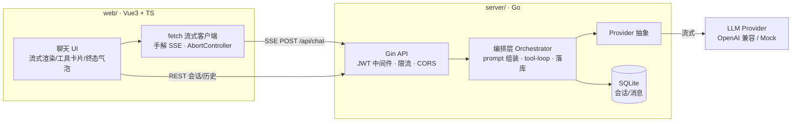

# chat-forge · 全栈 AI 对话助手

从 0 实现的智能对话助手,覆盖前后端:**Go (Gin + GORM + JWT + SSE)** × **Vue3 + TypeScript**。
不只是一个聊天 Demo——它把生产级 AI 助手的关键工程问题(流式、工具循环、取消传播、终态收敛、可测试性)都做成了可运行的参考实现。

## ✨ 核心特性

- **SSE 流式对话**——fetch + ReadableStream 手解(不用 EventSource:它不支持 POST + JWT header);打字机渲染 Markdown(渲染前 sanitize 防 XSS)
- **Function Calling 工具循环**——编排层带最大轮次封顶;工具失败也结构化回喂模型自纠;前端把调用过程渲染成可折叠卡片
- **全链路取消传播**——前端点「停止」→ abort fetch → 后端 `r.Context()` 取消 → 上游 LLM 请求同步取消,不白烧 token
- **终态收敛**——任何中断(断网/手动停止/出错)都收敛为显式终态(成功/失败/已停止),气泡永不永久 loading
- **Provider 抽象 + Mock 一等公民**——`AI_PROVIDER=mock` 离线跑通全流程;测试与 CI 零 API key;换真实模型只改环境变量
- **SSE 心跳 + 断连宽限**——15s 心跳注释行防代理掐连接;nginx 反代关闭 buffering
- **JWT 认证 + 会话隔离**——注册/登录、会话 CRUD,所有资源带归属校验防越权
- **限流**——每 IP/路由滑动窗口(内存版,生产换 Redis 的路径已在注释标注)

## 🏗 架构



### 后端分层

```
server/internal/
├── api/         HTTP 层:SSE 端点(Flusher/心跳/取消)、认证、会话 CRUD
├── chat/        编排层:prompt 组装 → 调模型 → 工具循环(MaxRounds 封顶) → 消息落库
├── provider/    模型抽象:OpenAI 兼容协议(流式+tool_calls 增量聚合) + Mock
├── tool/        工具注册表:定义(JSON Schema) + 执行收口,新增工具零改编排层
├── middleware/  CORS、滑动窗口限流
├── auth/        JWT 签发/校验、bcrypt
├── model/       GORM 模型(与 OpenAI messages 协议对齐,历史可直接回放)
└── store/       SQLite(纯 Go 驱动,无 cgo)
```

### 关键设计决策

| 决策 | 理由 |
|---|---|
| tool 失败不中断,结构化回喂模型 | 失败是信息不是异常——模型看到错误原因可自纠(换参数/换工具/向用户澄清) |
| 历史消息形状对齐 OpenAI messages 协议落库 | 回放历史可直接拼进 provider 请求,不做二次转换 |
| SSE 心跳用注释行(`: ping`) | 心跳不产生事件,前端解析器天然忽略;防 nginx `proxy_read_timeout` 掐长连接 |
| 取消沿 `context` 一条线贯通 | 客户端断开是常态——不算账的服务养不起 |
| Mock provider 与真实现同接口 | 「没有 key 跑不了」是 AI 项目最常见的死法;CI 里跑的 Mock 测试就是工具循环的回归护栏 |

## 🚀 快速开始

### 方式一:零配置离线跑(Mock 模型)

```bash
# 1. 起后端(默认 mock provider)
cd server && go run . 

# 2. 起前端(另开终端)
cd web && npm install && npm run dev
# 打开 http://localhost:5173,注册一个账号即可对话
```

> 发送「今天杭州天气怎么样」可端到端演示 Function Calling:模型发起工具调用 → 服务端执行 → 结果回喂 → 最终回答,前端以可折叠卡片展示全过程。

### 方式二:接入真实模型

```bash
cd server
AI_PROVIDER=openai \
OPENAI_BASE_URL=https://api.deepseek.com/v1 \
OPENAI_API_KEY=sk-xxx \
OPENAI_MODEL=deepseek-chat \
go run .
```

兼容一切 OpenAI 协议端点:DeepSeek / Kimi / Qwen / OpenAI / 本地 vLLM。

### 方式三:Docker Compose 一键起

```bash
cp .env.example .env   # 按需改 AI_PROVIDER / OPENAI_API_KEY
docker compose up --build
# 前端 http://localhost:8081(server 内部同源反代,SSE 已关 buffering)
```

## 🧪 测试

```bash
cd server && go test ./... -timeout 120s
```

`internal/chat/orchestrator_test.go` 端到端验证工具循环:用户提问 → 模型发起 tool_call → 服务端执行 → 结果落库 → 最终回答,并校验落库消息序列为 `user → assistant(tool_calls) → tool → assistant`。全程 Mock,CI 零依赖。

## 📋 API 摘要

| 方法 | 路径 | 说明 |
|---|---|---|
| POST | `/api/auth/register` `/api/auth/login` | 注册/登录,返回 JWT |
| POST | `/api/chat` | **SSE 流式对话**(事件: delta / tool_call / tool_result / done / error) |
| GET/POST/DELETE | `/api/conversations` | 会话列表/新建/删除 |
| GET | `/api/conversations/:id/messages` | 会话历史 |
| GET | `/healthz` | 健康检查 |

## 🔭 Roadmap

- [ ] RAG:文档切片 + pgvector 检索,回答带引用来源
- [ ] token 计量与每用户预算限流
- [ ] 评测集:20 个固定问题的回归基线
- [ ] 会话标题自动摘要

## License

MIT
